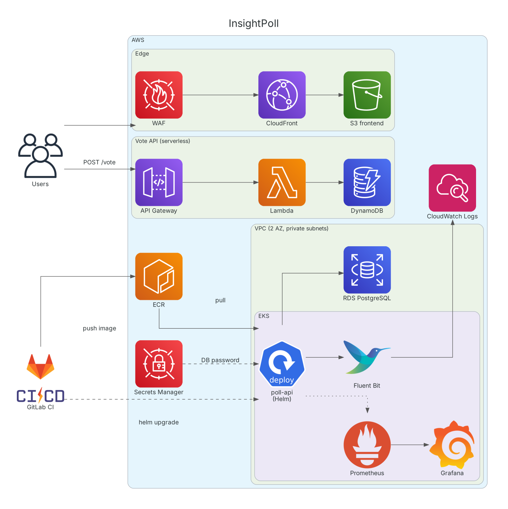

# InsightPoll: A Cloud-Native, CI/CD-Driven Polling Application on Kubernetes

This project is a comprehensive, end-to-end implementation of a modern DevOps lifecycle, demonstrating a full suite of cloud-native tools and practices. The goal is to build, deploy, and manage a scalable microservices-based polling application on AWS, fully automated with a GitLab CI/CD pipeline.

## 🚀 Core Features

- **Infrastructure as Code (IaC):** The entire AWS infrastructure is defined and managed using Terraform.
- **Containerization & Orchestration:** The main application is containerized with Docker and deployed on a managed Kubernetes cluster (Amazon EKS) using Helm charts.
- **CI/CD Automation:** Every `git push` to the `master` branch automatically triggers a GitLab CI pipeline that tests, builds, and deploys the application to the EKS cluster.
- **Serverless Microservice:** A high-traffic voting endpoint is handled by a serverless stack (API Gateway, Lambda, DynamoDB) for maximum scalability and cost-efficiency.
- **Observability:**
  - **Monitoring:** The EKS cluster and application metrics are scraped by Prometheus and visualized in Grafana dashboards.
  - **Logging:** All container logs are collected by Fluent Bit and centralized in Amazon CloudWatch Logs for analysis.
- **Security:** A foundational security layer is implemented using AWS WAF on the frontend distribution.

## 🏛️ Architecture Diagram

The following diagram illustrates the complete architecture of the system, from code commit to a live, monitored application.



## 🛠️ Technology Stack

| Domain                  | Technologies Used                                                                 |
| ----------------------- | --------------------------------------------------------------------------------- |
| **Cloud Provider** | AWS (Amazon Web Services)                                                         |
| **Infrastructure as Code** | Terraform                                                                       |
| **Containerization** | Docker                                                                            |
| **Orchestration** | Kubernetes (Amazon EKS), Helm                                                     |
| **CI/CD** | GitLab CI                                                                         |
| **Application Backend** | Python (Flask), Node.js (for future services)                                     |
| **Databases** | Amazon RDS (PostgreSQL), Amazon DynamoDB (NoSQL)                                  |
| **Serverless** | AWS Lambda, Amazon API Gateway                                                    |
| **Observability** | Prometheus, Grafana, Amazon CloudWatch, Fluent Bit                                |
| **Networking & CDN** | Amazon VPC, CloudFront                                                            |
| **Security** | AWS WAF, AWS IAM, AWS Secrets Manager                                             |

## 📁 Repository Layout

| Path | Contents |
|---|---|
| `insight-pool-infra/` | Terraform: VPC (2 AZs, public/private subnets, NAT), EKS + node group, IRSA roles (EBS CSI, Fluent Bit), RDS PostgreSQL, ECR, Lambda, API Gateway, DynamoDB, S3 + CloudFront (OAC) + WAF |
| `poll-api/` | Flask API, Dockerfile, Helm chart and GitLab CI pipeline |
| `lambda-code/` | Serverless vote handler (API Gateway → Lambda → DynamoDB) |
| `frontend/` | Static voting UI served from S3 through CloudFront |

## 🔐 Security & Reliability Practices

- **Secrets:** the RDS password is generated by Terraform (`random_password`) and stored in AWS Secrets Manager; it never appears in code.
- **IRSA:** add-ons such as the EBS CSI driver and Fluent Bit get their own IAM roles through the EKS OIDC provider instead of using node credentials.
- **Least privilege:** the Lambda role can only `PutItem` into the votes table.
- **Private data layer:** RDS and worker nodes run in private subnets; the DB security group only accepts traffic from the EKS cluster security group.
- **Hardened container:** the API runs under gunicorn as a non-root user, with readiness/liveness probes and resource requests/limits in the Helm chart.
- **Edge protection:** the S3 bucket is private (CloudFront Origin Access Control) and CloudFront is protected by the AWS managed WAF core rule set.

## 🧭 Trade-offs & Next Steps

These are deliberate simplifications to keep the demo affordable, and the next things I would change for production:

- **Single NAT Gateway** (cost) → one NAT per AZ for full high availability.
- **Local Terraform state** → S3 backend with state locking.
- **Manually created `db-credentials` Kubernetes secret** → External Secrets Operator syncing from Secrets Manager.
- **RDS** → enable storage encryption, automated backups and Multi-AZ.
- **EKS** → pin the Kubernetes version and restrict public API endpoint access.

## 🚀 Deploy

```bash
cd insight-pool-infra
terraform init
terraform apply

aws eks update-kubeconfig --region eu-central-1 --name InsightPoll-EKS-Cluster

# Kubernetes secret the API reads its DB password from
kubectl create secret generic db-credentials --from-literal=password="$(aws secretsmanager get-secret-value \
  --secret-id "$(terraform output -raw db_password_secret_arn)" --query SecretString --output text | jq -r .password)"

helm upgrade --install poll-api ../poll-api/helm-charts/poll-api \
  --set image.repository="$(terraform output -raw ecr_repository_url)" --set image.tag=<tag>

terraform destroy   # tear down to avoid costs
```
